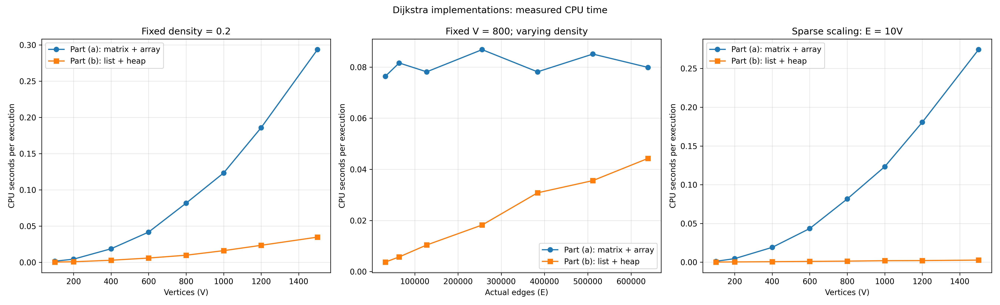
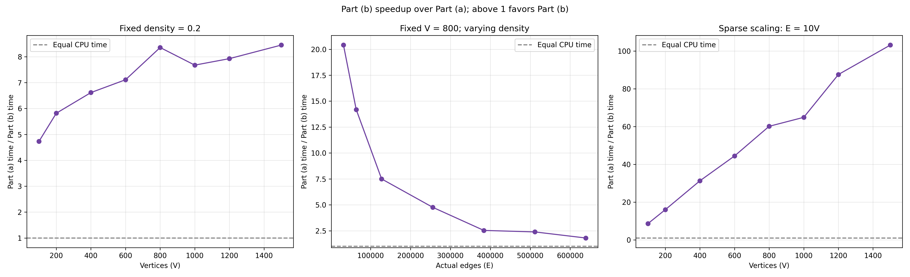

# Project 2, Part (c): Comparing the Dijkstra implementations

Part (a) stores a directed graph in an adjacency matrix and selects the next
vertex with an array scan. Part (b) stores it in adjacency lists and selects
the next vertex with a binary min-heap. Both implementations compute the same
shortest distances on every paired benchmark graph.

## Theoretical comparison

| Implementation | Worst-case time | Total space including graph | Reason |
|---|---|---|---|
| (a) Matrix + array | O(V²) | O(V²) | Selecting a minimum and scanning a matrix row each take O(V), up to V times. The matrix stores V² entries, including absent edges. |
| (b) Adjacency list + binary heap | O((V + E) log V) | O(V + E) | Neighbor scans process existing edges. Each successful relaxation inserts a new heap entry; stale entries are skipped when popped. There is no decrease-key operation. |

The heap can contain O(E+1) entries because it uses lazy insertion and starts
with the source vertex, even when E=0. Its heap operations therefore cost
O(log(E+2)), which is O(log(V+1)) for the simple directed graphs here, where
E ≤ V(V−1). For V≥2, this gives the stated Part (b) bound.

For **sparse graphs**, E = Θ(V), so Part (b) is O(V log V) while Part (a)
remains O(V²). For **fixed positive density**, E = Θ(V²): Part (a) has the
better asymptotic time bound, O(V²) versus O(V² log V). At fixed V=800,
varying E does not change the matrix dimensions, so Part (a)'s operation
count should be approximately flat; Part (b)'s edge and heap work grows with E.
These are asymptotic bounds, not predicted CPU seconds.

## Empirical comparison

Both implementations were timed on exactly the same three generated graphs
per configuration, with three `time.process_time()` trials per graph. Timed
batches address coarse CPU-clock resolution. Times below are mean CPU seconds
per Dijkstra execution; E is the mean actual directed edge count across the
three graphs. A/B is Part (a) time divided by Part (b) time, so values above
one favor Part (b).

| Experiment | V | Mean E | Part (a), s | Part (b), s | A/B |
|---|---:|---:|---:|---:|---:|
| Density 0.2 | 100 | 1,993 | 0.001492 | 0.000315 | 4.73 |
| Density 0.2 | 1,500 | 448,951 | 0.293403 | 0.034722 | 8.45 |
| Fixed V, density 0.05 | 800 | 32,042 | 0.076389 | 0.003743 | 20.41 |
| Fixed V, density 1.0 | 800 | 639,200 | 0.079861 | 0.044271 | 1.80 |
| Sparse, E = 10V | 100 | 1,000 | 0.001112 | 0.000129 | 8.63 |
| Sparse, E = 10V | 1,500 | 15,000 | 0.274306 | 0.002658 | 103.18 |

The figures include every configuration; the table shows endpoints to make
the trends concrete. Across the eight fixed-density vertex counts, Part (b)
was faster at every point. Although density 0.2 implies E = Θ(V²), the
matrix's asymptotic advantage did not translate into lower CPU time for the
tested V=100–1,500 range. Theoretical bounds do not specify the constants
and Python execution costs that matter at these sizes.

At fixed V=800, Part (a)'s measured time stayed near 0.08 seconds as E rose
from about 32,000 to 639,200. Part (b)'s time rose from about 0.0037 to
0.0443 seconds. Consequently, its observed advantage narrowed from 20.41×
to 1.80×, but it remained faster even at density 1.0. This agrees with the
matrix scanning all V positions in a row while the adjacency-list version
processes more actual edges and heap entries as E rises.

For E=10V, Part (b)'s advantage grew from 8.63× at V=100 to 103.18× at
V=1,500. This is consistent with its O(V log V) sparse-graph bound versus
the matrix's O(V²) bound. These ratios describe this run; they are not
universal speedup factors.

## Which implementation is better, and when?

**For the tested graphs and machine, Part (b) was faster in every measured
configuration.** It is the stronger choice for sparse graphs, especially as
V increases, and uses O(V+E) rather than O(V²) storage when E is small.

For dense graphs, Part (a) has the better *worst-case asymptotic time bound*.
Its performance also changed little with E at fixed V, while Part (b)'s
advantage narrowed as density increased. Nevertheless, these measurements
show no point at which Part (a) becomes faster. A practical crossover must
not be claimed from this dataset. At E = Θ(V²), both representations also
require O(V²) asymptotic space.

Representation availability matters to an end-to-end decision. These CPU
times exclude matrix-to-list conversion. If input is supplied as a matrix
and only one shortest-path query is needed, conversion has a cost that this
comparison does not measure. If an adjacency list already exists or is reused
for many queries, that conversion concern is reduced.

## Limits of the evidence

- The CSVs contain only means, not individual trials, spread, or confidence
  intervals; small differences should not be treated as statistically proven.
- Results come from one rerun on one machine and execution environment. The
  rerun was performed with other applications closed except VS Code, but
  hardware and load can still affect CPU timings.
- Graphs are randomly generated, directed, and use default positive integer
  weights 1–100. Correctness tests cover zero-weight and disconnected cases,
  but these are not separate benchmark populations.
- The benchmark uses source vertex 0. Graph generation, representation
  conversion, plotting, and CSV writing are excluded from timed sections;
  each algorithm's input validation is included.
- Memory complexity is theoretical here: peak memory use was not measured.
  No practical runtime crossover or end-to-end representation cost was
  measured beyond the sampled configurations.
