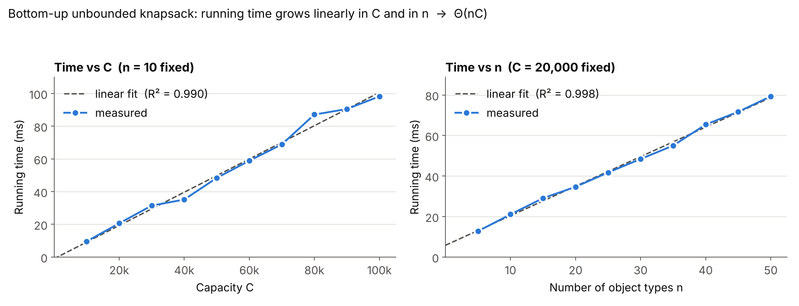

# SC2001 Project 3: Dynamic Programming (Unbounded Knapsack)

A knapsack has capacity **C**. There are **n** object types, with unlimited copies of each.
Object *i* has weight *w<sub>i</sub>* and profit *p<sub>i</sub>*, and all values are positive integers.
**P(C)** is the largest total profit of any set of objects that fits in the knapsack.

## Recursive definition (Part 1)

```
P(C) = 0                                                         if C = 0
P(C) = max( {0} ∪ { p_i + P(C − w_i) | 0 ≤ i < n, w_i ≤ C } )    if C > 0
```

## Subproblem graph (Part 2)

Subproblem graph for P(15) with w = [4, 5, 8] and p = [7, 6, 9]: [`Subproblem Diagram.png`](Subproblem%20Diagram.png).
Each distinct capacity appears once; P(1), P(2) and P(3) are leaves because no object fits, and P(4) is not reachable from P(15).

## Bottom-up algorithm (Parts 3 and 4)

`knapsack(C, n, w, p)` in `knapsack_part4.py` follows the Part 3 pseudocode line by line:

```
create array profit[0..C];  profit[0] = 0
for c = 1 to C:
    profit[c] = 0
    for i = 0 to n-1:
        if w[i] <= c and profit[c] < p[i] + profit[c - w[i]]:
            profit[c] = p[i] + profit[c - w[i]]
return profit[C]
```

The algorithm runs in **Θ(nC) time** and **Θ(C) space**. This is pseudo-polynomial: it is polynomial in the *value* of C, not in the number of bits needed to write C.

## Results (Part 4)

| Case | Weights w | Profits p | C | Max profit | Optimal selection |
|---|---|---|---|---|---|
| 4(a) | 4, 5, 8 | 7, 6, 9 | 16 | **P(16) = 28** | 4 × object 0 |
| 4(b) | 5, 6, 7 | 7, 6, 9 | 12 | **P(12) = 16** | object 0 + object 2 |

Each answer is checked against two independent methods, top-down memoisation and brute-force enumeration. The program also checks 300 random small inputs and a few edge cases against brute force. The full console output is in `part4_output.txt`.

### Empirical running time



The running time grows linearly in C when n is fixed (R² ≈ 0.99), and linearly in n when C is fixed (R² ≈ 0.998). This agrees with the Θ(nC) analysis.

## How to run

```bash
python knapsack_part4.py            # 4(a) and 4(b): DP table, answer, traceback, verification
python knapsack_part4.py --bench    # also prints a small running-time table
pip install -r requirements.txt     # matplotlib, needed only for the plot below
python plot_part4_runtime.py        # timing experiment -> runtime_analysis.png, runtime_data.json
```

The code needs Python 3.8+. `knapsack_part4.py` uses only the standard library.

## Files

| File | Purpose |
|---|---|
| `knapsack_part4.py` | Part 4: bottom-up DP, traceback, verification, self-test |
| `plot_part4_runtime.py` | Empirical analysis: times `knapsack()` for growing C and n, then plots the results |
| `part4_output.txt` | Console output of `python knapsack_part4.py --bench` |
| `runtime_analysis.png`, `runtime_data.json` | Timing plot and the raw numbers behind it |
| `screenshots/` | Code and output images used in the slides |
| `requirements.txt` | Python dependency for the plot script |
